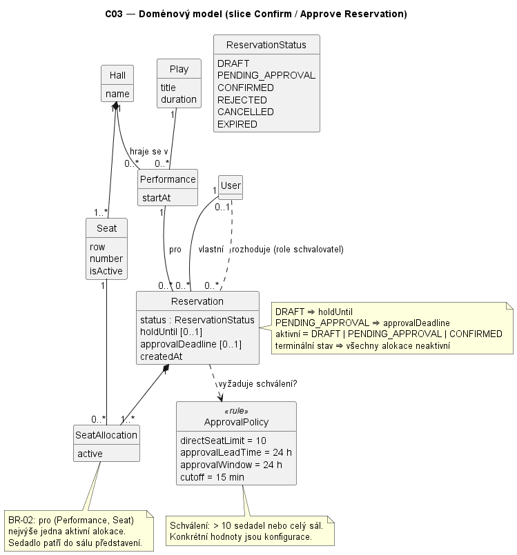

# C03 — Architecture design

← [Navigator](../NAVIGATOR.md) · [Traceability](../TRACEABILITY.md) · Related: [AS-IS mapping](../architecture-and-decisions/C03-AS-IS-Mapping.md) · [C03 evidence](../evidence-and-evolution/C03-Architecture-Evidence.md)

Sledovaný scénář zůstává OP-03 (Confirm Reservation), konkrétně větev
`DRAFT → PENDING_APPROVAL` (více než 10 sedadel) s pozdějším OP-05 (Approve Reservation).

Písmena v nadpisech (B–F) odpovídají krokům zadání C03. Kódy D1–D4 jsou
architektonické drivery z části B, kódy R1–R8 odpovědnosti z části C2.

## B. Architecture drivers

| # | Podklad / zdroj | Proč ovlivňuje architekturu | Otázka, kterou musí architektura vyřešit |
|---|---|---|---|
| D1 Souběh | `BR-02`, `BR-06`, `REQ-04`, budoucí tlak z C01 „20× souběžných rezervací“, AS-IS mapování: SQLite `IMMEDIATE`, chyba `busy` | Dva souběžné požadavky mohou oba vidět `DRAFT` nebo volné sedadlo; SQLite serializuje všechny zápisy, takže každý další zápis v transakci prodlužuje čekání ostatních. | Kde se dělá autoritativní rozhodnutí o přechodu a alokaci, aby uspěl jen jeden přechod a `BR-02` platilo i při souběhu? |
| D2 Zpožděné schválení | `REQ-06`, `REQ-07`, `BR-08`, stavový diagram: lhůta schválení 24 h, `hold_until` 5 min (`BR-07`) | `PENDING_APPROVAL` přežívá původní request; rozhodnutí přijde později od jiného aktéra nebo od časovače. | Kdo vlastní pending stav a lhůty a kdo provede pozdější přechod (approve / reject / expire)? |
| D3 Selhání notifikace | Hranice Notification Service a historické AS-IS mapování: `_notify` přes `on_commit(robust=True)`, adaptér jen loguje; C02 známé omezení „retry není implementováno“ | Historický návrh mohl ztratit notifikaci mezi commitem a odesláním. Aktuální C05 řešení zapisuje outbox ve stejné transakci a retry vlastní dispatcher. | Má selhání notifikace ovlivnit výsledek Confirm, kdo vlastní stav doručení a kdo řeší retry? |
| D4 Jediný vlastník lifecycle | Statechart C02 (3 spouštěče: návštěvník, schvalovatel, časovač), známé omezení: „přímé změny stavů přes ORM obcházejí pravidla služeb“ | Stejný lifecycle mění více vstupních bodů v různých procesech (`expire_reservations --watch`, testy/shell). | Která jediná část smí rozhodovat a měnit lifecycle `Reservation`, a které části ho smí jen vyžádat? |

Mechanismy (transakce, `select_for_update`, outbox, worker) jsou až kandidátní
řešení v E1, nejsou součástí driverů.

## C1. Domain class model

Diagram: [domain-model.puml](../diagrams/c03/domain-model.puml).



| Pojem | Význam pro sledovaný scénář | Vztahy / násobnosti |
|---|---|---|
| `Performance` | Konkrétní uvedení hry; určuje sál a začátek (cutoff 15 min, předstih 24 h). | `Play 1 — 0..* Performance`, `Hall 1 — 0..* Performance` |
| `Hall`, `Seat` | Sál a jeho sedadla; „celý sál“ spouští schválení. | `Hall 1 ◆— 1..* Seat` |
| `Reservation` | Stav lifecycle, `holdUntil`, `approvalDeadline`. | `Performance 1 — 0..* Reservation`, `User 1 — 0..* Reservation` (vlastník) |
| `SeatAllocation` (`ReservationSeat`) | Blokování sedadla rezervací; `active` odlišuje blokování od historie. | `Reservation 1 ◆— 1..* SeatAllocation`, `Seat 1 — 0..* SeatAllocation`; **BR-02**: pro `(Performance, Seat)` nejvýše jedna aktivní alokace |
| `User` | Návštěvník (vlastník) nebo schvalovatel (role/oprávnění). | rozhoduje `0..1 — 0..*` pending rezervací |
| `ApprovalPolicy` | Pravidlo „> 10 sedadel nebo celý sál“, předstih 24 h, lhůta 24 h, cutoff 15 min. | `Reservation ..> ApprovalPolicy` |

Invarianty na vztazích: `DRAFT ⇒ holdUntil`, `PENDING_APPROVAL ⇒ approvalDeadline`,
terminální stav ⇒ všechny alokace neaktivní. `Controller`, ORM managery ani
notifikační adaptér v modelu nejsou. Model odpovídá C02 (více sedadel na
rezervaci, stavy ze stavového diagramu); nový je jen explicitní pojem `ApprovalPolicy`,
který v kódu existuje jako `_requires_approval` + konstanty v `settings.py`.

## C2. System responsibilities

| # | Zdroj | Odpovědnost | Co musí rozhodovat / vlastnit | Jeden jasný vlastník? | Důvod |
|---|---|---|---|---|---|
| R1 Přechody lifecycle | OP-03/04/05 + stavový diagram, D4 Jediný vlastník lifecycle | Rozhodnout, zda je přechod lifecycle povolen, a provést ho | zdrojový stav, cílový stav, `holdUntil`, `approvalDeadline` | ano | různé vstupní body nesmí rozhodnout odlišně |
| R2 Alokace sedadel | `BR-02`, `BR-06`, D1 Souběh | Alokovat a uvolňovat sedadla, zachovat exkluzivitu | aktivní alokace pro `(performance, seat)` | ano | souběh nesmí porušit invariant |
| R3 Politika schválení | `BR-04`, `BR-08`, `REQ-03` | Vyhodnotit politiku schválení a časové hranice | „> 10 / celý sál“, 15 min, 24 h | ano | Create a Confirm musí použít stejné hranice |
| R4 Čekající schválení | `REQ-06/07`, D2 Zpožděné schválení | Spravovat pending approval a jeho lhůtu | `PENDING_APPROVAL`, `approvalDeadline`, výsledek approve/reject | ano | stav přežívá request, rozhoduje jiný aktér |
| R5 Spouštění expirace | `BR-07`, stavový diagram „expire“, D2 Zpožděné schválení | Spouštět časově řízené přechody (expirace) | nic – jen požádá o přechod v okamžiku `now ≥ deadline` | ne (spouštěč) | rozhodnutí patří R1 Přechody lifecycle; časovač může běžet zpožděně |
| R6 Oprávnění | OP-03/05 předpoklady | Ověřit oprávnění aktéra (vlastník / `approve_reservation`) | autorizační rozhodnutí pro operaci | ano | stejná operace nesmí mít různá pravidla přístupu |
| R7 Záznam oznámení | D3 Selhání notifikace, stavový diagram (approval_requested, approved, rejected, expired) | Rozhodnout, *že* a *co* se má oznámit | záznam „oznámení je potřeba“ pro danou změnu stavu | ano | musí odpovídat skutečně commitnuté změně |
| R8 Doručení oznámení | D3 Selhání notifikace, hranice Notification Service | Doručit oznámení a řešit retry | stav doručení, počet pokusů, další pokus | podle návrhu | externí selhání musí mít definovaný význam |

| # | Musí být seskupena s | Má být oddělena od |
|---|---|---|
| R1 Přechody lifecycle | R2 Alokace sedadel, R4 Čekající schválení – sdílí stav `Reservation` a musí být v jedné atomické změně (terminální stav = uvolnění sedadel) | R5 Spouštění expirace (jiný proces a čas spuštění), R8 Doručení oznámení (externí failure) |
| R2 Alokace sedadel | R1 Přechody lifecycle – uvolnění/alokace je součástí přechodu | prezentace dostupnosti (read-only dotaz OP-02) |
| R3 Politika schválení | R1 Přechody lifecycle – je vstupem rozhodnutí | konkrétních hodnot (konfigurace – mění je provoz, ne kód) |
| R4 Čekající schválení | R1 Přechody lifecycle, R2 Alokace sedadel – approve/reject/expire mění stejný stav a alokace | identity/autorizace (R6 Oprávnění), časovače (R5 Spouštění expirace) |
| R5 Spouštění expirace | – (jen spouštěč) | R1 Přechody lifecycle: nesmí sám měnit stav, jinak vznikne druhý vlastník lifecycle |
| R6 Oprávnění | – | domény (Django auth / budoucí IdP je jiná technologie a trust boundary) |
| R7 Záznam oznámení | R1 Přechody lifecycle – záznam musí vzniknout ve stejné transakci jako změna stavu | R8 Doručení oznámení – jiná technologie, jiný důvod změny, externí failure |
| R8 Doručení oznámení | – | R1 Přechody lifecycle, R7 Záznam oznámení – pád Notification Service nesmí rozbít ani držet transakci lifecycle |

## D. Main decision question

```text
Rozhodovací otázka:
Kde má být izolována integrace s Notification Service, kdo vlastní stav
doručení a retry a co znamená selhání notifikace pro Confirm Reservation
(větev DRAFT → PENDING_APPROVAL)?
```

Vychází z D3 Selhání notifikace (a dotýká se D1 Souběh, D2 Zpožděné schválení). Má dopad na ownership (R7 Záznam oznámení, R8 Doručení oznámení), interakci
(synchronní volání vs. asynchronní předání) i runtime (kdo a v jakém procesu
odesílá). D1 Souběh je podle AS-IS mapování už řešen DB transakcí a constraintem;
bude ověřen později (krok L zadání C03), ale nemá dvě rovnocenné reálné alternativy pro náš stack.

## E1. Alternatives

**Alternativa A — synchronní best-effort po commitu (zpřesnění AS-IS)**

```text
[Reservation Application – request]
  [Reservation Management]  owns: lifecycle, alokace, lhůty
        | po commitu (on_commit): notify(reservation, event)
        v
  [Notification Integration]  adaptér, timeout, chyba → log
        | HTTP / SDK volání, 1 pokus
        v
[Notification Service]
```

- Stav doručení nikdo nevlastní; selhání se jen zaloguje.
- Výsledek Confirm se selháním nemění (commit už proběhl).
- Žádná nová tabulka ani proces.

**Alternativa B — transakční outbox + dispatcher**

```text
[Reservation Application – request]
  [Reservation Management]  owns: lifecycle, alokace, lhůty
        | ve stejné transakci: record(NotificationRequest)
        v
     (DB: tabulka notification outbox)
        ^
        | claim pending / mark SENT | FAILED
[Background worker – expire_reservations --watch / dispatch]
  [Notification Dispatch]  owns: stav doručení, pokusy, backoff
        | send(request) přes adaptér
        v
  [Notification Integration] ──► [Notification Service]
```

- Reservation Management jen *zaznamená požadavek* (R7 Záznam oznámení) atomicky se změnou stavu.
- Doručení a retry (R8 Doručení oznámení) vlastní Notification Dispatch v background procesu.
- Confirm na Notification Service vůbec nečeká.

## E2. Comparison against drivers

| Driver / kritérium | Alternativa A | Alternativa B |
|---|---|---|
| D3 Selhání notifikace – failure behaviour | Výpadek, timeout nebo pád procesu mezi commitem a voláním notifikaci nenávratně ztratí; zůstane jen řádek v logu. Retry by šel jen inline a prodlužoval by request. | Požadavek je v DB ve stejné transakci jako změna stavu → přežije pád i restart. Dispatcher opakuje s backoffem; po N pokusech `FAILED` = viditelný, dotazovatelný stav. Doručení je *at-least-once* → nutný idempotency klíč (ID outbox záznamu). |
| D2 Zpožděné schválení – zpožděné schválení | Pokud se `approval_requested` ztratí, schvalovatel se o žádosti nedozví; rezervace po 24 h vyprší a sedadla jsou celou dobu zbytečně blokovaná. | Schvalovatel je informován, jakmile je služba dostupná (zpoždění = interval workeru + backoff, ≪ 24 h). Lhůtu a přechod dál vlastní Reservation Management – dispatcher je nemění. |
| D1 Souběh – konzistence a souběh na SQLite | Žádný zápis navíc v rezervační transakci. Volání je mimo transakci, takže zámek nedrží; ale request (a vlákno serveru) čeká na externí timeout. | Jeden `INSERT` navíc v transakci Confirm/Approve/Expire (krátký, bez I/O). Dispatcher zapisuje stav doručení → další spisovatel do SQLite. Nutné: externí volání **mimo** transakci (claim → commit → send → mark), jinak by držel writer lock. |
| D4 Jediný vlastník lifecycle – ownership / změna | Notifikační logika je volána přímo ze služeb; R7 Záznam oznámení i R8 Doručení oznámení v praxi leží v Reservation Management. Změna vendor API nebo retry politiky zasáhne request cestu. | R7 Záznam oznámení = Reservation Management, R8 Doručení oznámení = Notification Dispatch, vendor API jen v Notification Integration. Změna doručování nezasahuje do lifecycle kódu. |
| Provozní složitost | Nejjednodušší: bez nové tabulky, bez dalšího procesu. | Nová tabulka + migrace, samostatný příkaz `dispatch_notifications --watch` a monitoring `FAILED`/stáří `PENDING`. Dispatcher je samostatný worker, ale ne nový aplikační deployable. |

## E3. Scenario walkthrough

Scénář: OP-03 Confirm rezervace 12 sedadel (> 10) → `PENDING_APPROVAL`.
Komplikace: Notification Service je v okamžiku potvrzení nedostupná (timeout),
za 10 minut se obnoví; navíc proces aplikace spadne těsně po commitu.

| Krok / událost | Alternativa A | Alternativa B |
|---|---|---|
| `Confirm Reservation` začne | Reservation Management zamkne představení a rezervaci, ověří vlastníka, `DRAFT`, `hold_until`, aktivní sedadla, předstih 24 h. | Stejné. |
| je potřeba approval | Nastaví `PENDING_APPROVAL`, `approvalDeadline = now + 24 h`; zaregistruje `on_commit(notify)`. Commit. | Nastaví `PENDING_APPROVAL`, `approvalDeadline`; **ve stejné transakci** vloží `NotificationRequest(approval_requested, PENDING)`. Commit. |
| volání Notification Service | Po commitu synchronní volání → timeout (např. 5 s); chyba se zaloguje, `robust=True` ji spolkne. Volající dostane `PENDING_APPROVAL` až po timeoutu. | Request nic neodesílá; volající dostane `PENDING_APPROVAL` hned. Dispatcher při dalším cyklu záznam převezme, volání selže → `attempts=1`, `next_attempt_at = now + backoff`. |
| proces/request skončí (pád procesu po commitu) | Pokud proces spadne mezi commitem a `on_commit` callbackem, notifikace se vůbec nepokusí; v DB po ní není stopa. | Záznam je v DB jako `PENDING`; po restartu ho dispatcher zpracuje. |
| Notification Service se obnoví | Nic se nestane – nikdo neví, že je co opakovat. | Další pokus uspěje → `SENT`. Pokud worker spadne po odeslání a před `SENT`, odešle se znovu → služba deduplikuje podle ID záznamu. |
| approval přijde později | Jen pokud schvalovatel náhodou sám zkontroluje frontu; jinak časovač po 24 h → `EXPIRED`, sedadla uvolněna až tehdy. | Schvalovatel zavolá OP-05 → Reservation Management ověří lhůtu a stav, nastaví `CONFIRMED` a ve stejné transakci zaznamená `approved` pro návštěvníka. |
| souběh: approve vs. expirace časovače | Obě cesty zamykají představení → rezervaci; uspěje první přechod, druhá dostane `invalid_state`/`expired`. Notifikace jen u vítěze (on_commit). | Stejné rozhodnutí v Reservation Management; outbox záznam vznikne jen v commitnuté (vítězné) transakci → nemůže odejít notifikace k přechodu, který neproběhl. |

Obě alternativy realizují požadované chování stavů; liší se v tom, zda
selhání notifikace může tiše zneplatnit D2 Zpožděné schválení (schvalovatel o žádosti neví).

## F. ADR-01 — Notification Service integration and the meaning of its failure

```text
## ADR-01 — Kde izolovat integraci s Notification Service a co znamená její selhání pro Confirm Reservation?

Kontext:
  Confirm (> 10 sedadel nebo celý sál) převádí rezervaci do PENDING_APPROVAL
  a schvalovatel o tom musí být informován, aby mohl rozhodnout do 24 h.
  AS-IS volal lokální adaptér přes transaction.on_commit(robust=True); selhání
  se jen zalogovalo a stav doručení se nikde neukládal. Aktuální C05 návrh
  používá transakční outbox a samostatný dispatcher nad SQLite.

Drivery:
  D3 – Notification Service může selhat; změna stavu je commitnuta dřív.
  D2 – PENDING_APPROVAL přežívá request; rozhodnutí přijde později.
  D1 – SQLite serializuje zápisy (pressure 20× souběžných rezervací).
  D4 – lifecycle Reservation smí měnit jen jeden vlastník.

Alternativa A:
  Synchronní best-effort volání adaptéru po commitu v rámci requestu,
  bez uloženého stavu doručení a bez retry.

Alternativa B:
  Transakční outbox: Reservation Management ve stejné transakci jako změnu
  stavu zapíše NotificationRequest; Notification Dispatch v background
  procesu doručuje přes Notification Integration s retry a backoffem
  a vlastní stav doručení (PENDING / SENT / FAILED).

Rozhodnutí:
  Alternativa B. Selhání notifikace NEMĚNÍ výsledek Confirm/Approve
  (business změna platí); povinnost oznámit je trvale zaznamenána
  a doručena at-least-once. Vendor/API Notification Service smí znát
  pouze Notification Integration.

Důvod:
  - Ztracené approval_requested by tiše zablokovalo sedadla až na 24 h
    a znehodnotilo schvalovací proces (D2, D3).
  - Notifikace vzniká jen pro commitnutý přechod – vítěz souběhu (D1, D4).
  - Request nečeká na externí službu a nedrží zámek SQLite během I/O.
  - Background proces už existuje, nový deployable nevzniká.

Přijaté negativní důsledky:
  - Notifikace je eventual: zpoždění = interval workeru + backoff.
  - At-least-once → možné duplicity; příjemce musí deduplikovat podle ID.
  - Nová tabulka a migrace; jeden INSERT navíc v rezervačních transakcích.
  - Dispatcher je další spisovatel do SQLite → vyšší šance na „busy“.
  - Bez běžícího workeru se nic neodešle → nutný provozní dohled (FAILED,
    stáří nejstaršího PENDING).

Rozhodnutí znovu otevřeme, když:
  - Notification Service nabídne vlastní trvalou frontu s potvrzením
    (outbox by duplikoval její odpovědnost);
  - přejdeme na PostgreSQL / message broker (dispatch lze přesunout do
    brokeru nebo LISTEN/NOTIFY);
  - měření při 20 souběžných požadavcích ukáže, že zápisy dispatcheru
    výrazně zvyšují počet chyb „busy“;
  - notifikace přestanou být pro schvalování podstatné (např. schvalovatel
    pracuje výhradně z fronty v UI).
```
