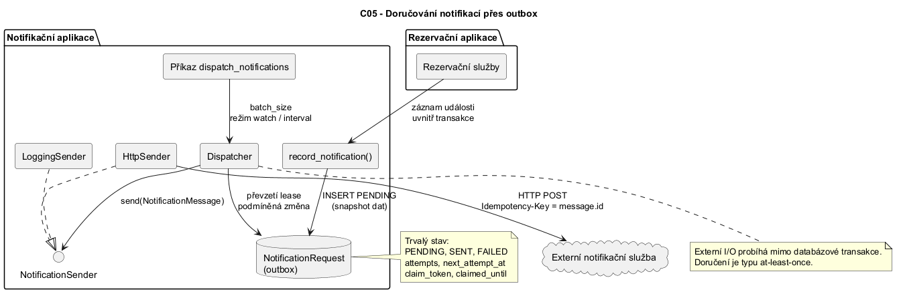

# C05 — Detailed Design

← [Navigator](../NAVIGATOR.md) · [Traceability](../TRACEABILITY.md) · Related: [C05 evidence](../evidence-and-evolution/C05-DD-Verification.md)

## Selected architecture responsibility / software unit

**Doručování notifikací přes outbox** je samostatná část uvnitř hranice
notifikační služby. Zahrnuje atomický zápis požadavku na notifikaci,
trvalý stav doručení, převzetí práce, opakování s prodlevou a adaptéry pro
skutečné odeslání. Rezervační služby pouze vytvoří outbox záznam uvnitř své
transakce; dispatcher se spouští samostatně po commitu.

Názvy sloupců v tabulkách této C05 dokumentace jsou ponechány v angličtině
podle zadané osnovy; obsah tabulek je vyplněn česky s diakritikou.

| Položka | Obsah |
|---|---|
| Související požadavky | Notifikace nesmí změnit výsledek rezervační operace; požadavek se nesmí ztratit mezi commitem rezervace a doručením; neúspěšné doručení se musí opakovat. |
| Související scénáře | `approval_requested`, `approved`, `rejected`, `expired`; jednorázové zpracování i `dispatch_notifications --watch`. |
| Relevantní pravidla | Outbox je součástí transakce rezervace; externí I/O nikdy nedrží databázovou transakci; doručení je typu at-least-once; příjemce deduplikuje podle stabilního ID. |
| Hranice | `reservation.services` -> `notification.services` -> `NotificationRequest`; `notification.dispatcher` -> `NotificationSender` -> externí služba. |

## Glossary

| Pojem | Význam |
|---|---|
| Outbox | Tabulka `NotificationRequest`, do které rezervační transakce zapíše požadavek na notifikaci. Doručení proběhne později. |
| Dispatcher | Část, která čte outbox a řídí doručování (`notification.dispatcher`). |
| Worker | Běžící proces, který dispatcher spouští. |
| Sender | Adaptér, který zprávu skutečně odešle (`NotificationSender`). |
| Snapshot | Kopie údajů o rezervaci uložená v okamžiku události. |
| Audience | Komu je zpráva určena: `approvers` nebo `owner`. |
| Claim | Převzetí záznamu workerem k doručení (`claim_token`). |
| Lease | Časově omezená platnost claimu (`claimed_until`). |
| Fencing | Výsledek se zapíše jen tehdy, když worker stále drží aktuální `claim_token`. Pozdní worker tak nepřepíše novější claim. |
| Sweep | Úklid: expirovaný claim s `attempts >= max` přejde do `FAILED`. |
| Backoff | Prodleva před dalším pokusem; zdvojnásobuje se až do nastaveného maxima. |
| At-least-once | Zpráva se doručí alespoň jednou, po pádu workeru i vícekrát. |

## Detailed responsibilities

| Detailed responsibility | Why is it needed? |
|---|---|
| Zapsat commitnutou událost | Zajistí, že změna rezervace a požadavek na notifikaci mají stejnou transakční hranici. |
| Uložit neměnný snapshot pro doručení | Dispatcher při pozdějším doručení nemusí znovu rekonstruovat historický stav rezervace. |
| Vybrat a převzít připravenou práci | Více workerů nesmí současně vlastnit stejný pokus o doručení. |
| Ohradit expirované nebo opožděné workery | Pozdní výsledek starého workeru nesmí přepsat novější claim. |
| Doručit přes kontrakt senderu | Dispatcher nezná HTTP ani jiný externí protokol. |
| Opakovat s omezenou prodlevou | Dočasné chyby se opakují, ale počet pokusů a prodleva mají horní mez. |
| Poskytnout provozní ovládání | Management command poskytuje jednorázové i průběžné zpracování a počty výsledků. |

## Design elements, ownership and data

| Responsibility  | Owner  | State/data | Why here? |
|---|---|---|---|
| Zapsat událost | `notification.services.record_notification` | event, snapshot rezervace, `PENDING` | Jediné místo validace podporovaných eventů a transakčního zápisu. |
| Trvalý stav doručení | `NotificationRequest` | `status`, `attempts`, `next_attempt_at`, `sent_at`, `last_error` | Stav musí přežít restart procesu. |
| Algoritmus převzetí a doručení | `notification.dispatcher` | `claim_token`, `claimed_until` | Lease a fencing patří k orchestraci workeru, nikoli k senderu. |
| Externí protokol | `NotificationSender` | `NotificationMessage` | Stabilní kontrakt umožňuje logging, HTTP i test double. |
| HTTP transport | `HttpSender` | endpoint, timeout, idempotency key | Pouze adaptér zná URL a HTTP protokol. |
| Lokální vývojový sink | `LoggingSender` | log event | Vývojový sender nepředstírá externí doručení. |
| Provozní smyčka | management command | interval, batch size, watch | CLI řeší životní cyklus procesu, nikoli business stav zprávy. |

## Interface / contract

```text
<<interface>> NotificationSender

send(message: NotificationMessage) -> None
```

**Předpoklady:**

- `message.id` je stabilní identifikátor outbox záznamu;
- `message.payload` je snapshot již commitnuté události;
- sender je připraven doručit nebo vyhodit výjimku.

**Následné podmínky při úspěchu:**

- sender nevrací hodnotu;
- dispatcher může označit konkrétní claim jako `SENT`.

**Chování při chybě:**

- sender vyhodí výjimku;
- dispatcher podle počtu pokusů nastaví `PENDING` s novým termínem, nebo `FAILED`;
- chyba se uloží zkrácená na 2000 znaků.

HTTP varianta posílá `message.id` také jako `Idempotency-Key`. Kontrakt
negarantuje doručení exactly-once; externí přijímač musí stejné ID
deduplikovat.

## Invariants and state model

```text
PENDING --převzetí--> PENDING + claim_token + claimed_until
PENDING --úspěšné odeslání--> SENT
PENDING --chyba odeslání a attempts < max--> PENDING + next_attempt_at
PENDING --chyba odeslání a attempts >= max--> FAILED
PENDING + expirovaný lease --obnovení--> PENDING + nový claim_token
PENDING + expirovaný lease + attempts >= max --sweep--> FAILED
```

Platí:

- pouze `PENDING` záznam s `next_attempt_at <= now` lze převzít;
- claim je platný jen společně s `claim_token` a `claimed_until`;
- úspěch ani chyba se zapíše pouze tehdy, když token stále patří workeru;
- `SENT` a `FAILED` nejsou znovu doručovány;
- `claim_token` a `claimed_until` jsou buď obě prázdné, nebo obě vyplněné;
- po překročení lease může vzniknout duplicitní odeslání, proto je nutná idempotence přijímače.

## Significant operations

### `record_notification(reservation, event)`

| Item | Design |
|---|---|
| Responsibility | Zapsat neměnný outbox požadavek jako součást transakce rezervace. |
| Input | Rezervace s `pk`, `owner_id`, `performance_id`, `status`; event z povolené množiny. |
| Output | Nový `NotificationRequest` ve stavu `PENDING`. |
| Preconditions | `connection.in_atomic_block` je pravda; event je podporovaný. |
| Postconditions | Payload obsahuje snapshot vlastníka, představení, stavu a audience. |
| Side effects | INSERT do outbox tabulky; při rollbacku záznam nezůstane. |
| Failure behavior | `RuntimeError` mimo transakci, `ValueError` pro nepodporovaný event. |

### `dispatch_notifications(batch_size, sender=None)`

| Item | Design |
|---|---|
| Responsibility | Zpracovat nejvýše daný počet připravených outbox záznamů. |
| Input | Kladné celé `batch_size`, volitelný `NotificationSender`. |
| Output | Počty `attempted`, `sent`, `retried`, `failed`. |
| Preconditions | Dispatcher neběží uvnitř transakce; timeout, lease, backoff a max attempts jsou kladné; lease je delší než timeout. |
| Postconditions | Každý převzatý claim je buď `SENT`, naplánovaný k opakování, nebo `FAILED`. |
| Side effects | DB claim/update a volání externího senderu mimo transakci. |
| Failure behavior | Chyba senderu se uloží a vede k opakování nebo `FAILED`; ztráta procesu se řeší expirací lease. |

### `HttpSender.send(message)`

| Item | Design |
|---|---|
| Responsibility | Převést `NotificationMessage` na HTTP POST. |
| Input | Zpráva se stabilním ID a JSON serializovatelným payloadem. |
| Output | Žádná hodnota při 2xx. |
| Failure behavior | Chybějící endpoint, síťová chyba nebo non-2xx odpověď vyvolá výjimku pro opakování dispatcherem. |

## Algorithm / decision logic

```text
ověř nastavení dispatcheru
opakuj nejvýše batch_size-krát:
    označ expirované claims s attempts >= max jako FAILED a započti je do failed
    převezmi první připravený PENDING požadavek
    pokud žádný požadavek neexistuje:
        skonči
    vytvoř NotificationMessage z uloženého snapshotu
    zavolej sender mimo databázovou transakci
    pokud je odeslání úspěšné:
        změň záznam na SENT, pokud stále odpovídá id a claim_token
    jinak:
        vypočti min(base * 2^(attempts - 1), max_backoff)
        změň záznam, pokud stále odpovídá id a claim_token
        -> PENDING s next_attempt_at nebo FAILED při maximu pokusů
vrať počty výsledků
```

Claim běží v krátké transakci. Vybere připravený řádek, provede podmíněnou
změnu na `(id, attempts)` a commitne lease před externím voláním. Pozdější
zápis úspěchu/chyby je podmíněn dvojicí `(id, status=PENDING,
claim_token=current)`; to je fencing proti pozdnímu workeru.

## Detailed sequence

1. `ReservationService` změní stav rezervace uvnitř `transaction.atomic`.
2. `_notify` zavolá `record_notification`.
3. `record_notification` ověří event a vloží `PENDING` snapshot.
4. Commit uloží rezervaci i outbox požadavek dohromady.
5. Management command zavolá `dispatch_notifications`.
6. Dispatcher převezme připravený požadavek a commitne lease.
7. Dispatcher zavolá `NotificationSender.send` mimo databázovou transakci.
8. Sender loguje lokálně nebo provede HTTP POST se stabilním idempotency key.
9. Dispatcher podmíněně označí požadavek jako `SENT`, naplánuje opakování,
   nebo jej označí `FAILED`.

Focused structural view: [c05-notification-outbox.puml](../diagrams/c05/c05-notification-outbox.puml).



## C03 baseline → actual C05 design

| Předpoklad C03 | Návrhové rozhodnutí C05 |
|---|---|
| Callback `on_commit` volá lokální loggingový adaptér | Rezervační transakce zapisuje trvalý outbox řádek přímo. |
| Notifikační služba nemá opakování | Dispatcher vlastní opakování, backoff, lease a terminální selhání. |
| Notifikační integrace je post-commit vedlejší účinek | Integrace je rozdělena na transakční zápis a asynchronní doručení. |
| Jeden lokální adaptér | `NotificationSender` podporuje loggingový i HTTP adaptér. |

## Detailed design (DD) decisions intentionally left to code

- deklarace polí Django modelu, syntaxe migrací a boilerplate administrace;
- triviální logovací příkaz `LoggingSender`;
- detaily konstrukce URL/požadavku, které nemění kontrakt senderu;
- boilerplate parseru management commandu;
- syntaxe ORM pro filtrování a řazení po stanovení claim invariantů.

Záměrná rizika jsou doručení typu at-least-once, možná duplicita po pádu po
externím přijetí, nejednoznačný lokální stav po pádu na posledním pokusu a
neúplné ověření paralelních workerů na SQLite.
