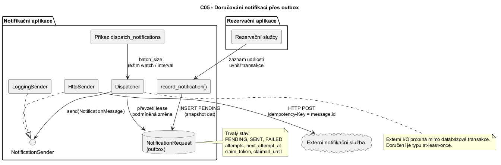

# C05 — Detailed Design

← [Navigator](../NAVIGATOR.md) · [Traceability](../TRACEABILITY.md) · Related: [C05 evidence](../evidence-and-evolution/C05-DD-Verification.md)

## Selected architecture responsibility / software unit

**Doručování notifikací přes outbox** je samostatná část uvnitř hranice
notifikační služby. Zahrnuje atomický zápis požadavku na notifikaci,
trvalý stav doručení, převzetí práce, opakování s prodlevou a adaptéry pro
skutečné odeslání. Rezervační služby pouze vytvoří outbox záznam uvnitř své
transakce; dispatcher se spouští samostatně po commitu.

Druhou detailně navrženou jednotkou je **vytvoření rezervace**
(`create_reservation`, OP-01 Create Reservation), viz část
[Create Reservation — detailed design](#create-reservation--detailed-design).

Názvy sloupců v tabulkách této C05 dokumentace jsou ponechány v angličtině
podle zadané osnovy; obsah tabulek je vyplněn česky s diakritikou.

| Položka | Obsah |
|---|---|
| Související požadavky | Notifikace nesmí změnit výsledek rezervační operace; požadavek se nesmí ztratit mezi commitem rezervace a doručením; neúspěšné doručení se musí opakovat. |
| Související scénáře | `approval_requested`, `approved`, `rejected`, `expired`; jednorázové zpracování i `dispatch_notifications --watch`. |
| Relevantní pravidla | Outbox je součástí transakce rezervace; externí I/O nikdy nedrží databázovou transakci; doručení je typu at-least-once; příjemce deduplikuje podle stabilního ID. |
| Hranice | `reservation.services` -> `notification.services` -> `NotificationRequest`; `notification.dispatcher` -> `NotificationSender` -> externí služba. |

## Glossary

| Pojem | Význam |
|---|---|
| Outbox | Tabulka `NotificationRequest`, do které rezervační transakce zapíše požadavek na notifikaci. Doručení proběhne později. |
| Dispatcher | Část, která čte outbox a řídí doručování (`notification.dispatcher`). |
| Worker | Běžící proces, který dispatcher spouští. |
| Sender | Adaptér, který zprávu skutečně odešle (`NotificationSender`). |
| Snapshot | Kopie údajů o rezervaci uložená v okamžiku události. |
| Audience | Komu je zpráva určena: `approvers` nebo `owner`. |
| Claim | Převzetí záznamu workerem k doručení (`claim_token`). |
| Lease | Časově omezená platnost claimu (`claimed_until`). |
| Fencing | Výsledek se zapíše jen tehdy, když worker stále drží aktuální `claim_token`. Pozdní worker tak nepřepíše novější claim. |
| Sweep | Úklid: expirovaný claim s `attempts >= max` přejde do `FAILED`. |
| Backoff | Prodleva před dalším pokusem; zdvojnásobuje se až do nastaveného maxima. |
| At-least-once | Zpráva se doručí alespoň jednou, po pádu workeru i vícekrát. |

## Detailed responsibilities

| Detailed responsibility | Why is it needed? |
|---|---|
| Zapsat commitnutou událost | Zajistí, že změna rezervace a požadavek na notifikaci mají stejnou transakční hranici. |
| Uložit neměnný snapshot pro doručení | Dispatcher při pozdějším doručení nemusí znovu rekonstruovat historický stav rezervace. |
| Vybrat a převzít připravenou práci | Více workerů nesmí současně vlastnit stejný pokus o doručení. |
| Ohradit expirované nebo opožděné workery | Pozdní výsledek starého workeru nesmí přepsat novější claim. |
| Doručit přes kontrakt senderu | Dispatcher nezná HTTP ani jiný externí protokol. |
| Opakovat s omezenou prodlevou | Dočasné chyby se opakují, ale počet pokusů a prodleva mají horní mez. |
| Poskytnout provozní ovládání | Management command poskytuje jednorázové i průběžné zpracování a počty výsledků. |

## Design elements, ownership and data

| Responsibility  | Owner  | State/data | Why here? |
|---|---|---|---|
| Zapsat událost | `notification.services.record_notification` | event, snapshot rezervace, `PENDING` | Jediné místo validace podporovaných eventů a transakčního zápisu. |
| Trvalý stav doručení | `NotificationRequest` | `status`, `attempts`, `next_attempt_at`, `sent_at`, `last_error` | Stav musí přežít restart procesu. |
| Algoritmus převzetí a doručení | `notification.dispatcher` | `claim_token`, `claimed_until` | Lease a fencing patří k orchestraci workeru, nikoli k senderu. |
| Externí protokol | `NotificationSender` | `NotificationMessage` | Stabilní kontrakt umožňuje logging, HTTP i test double. |
| HTTP transport | `HttpSender` | endpoint, timeout, idempotency key | Pouze adaptér zná URL a HTTP protokol. |
| Lokální vývojový sink | `LoggingSender` | log event | Vývojový sender nepředstírá externí doručení. |
| Provozní smyčka | management command | interval, batch size, watch | CLI řeší životní cyklus procesu, nikoli business stav zprávy. |

## Interface / contract

```text
<<interface>> NotificationSender

send(message: NotificationMessage) -> None
```

**Předpoklady:**

- `message.id` je stabilní identifikátor outbox záznamu;
- `message.payload` je snapshot již commitnuté události;
- sender je připraven doručit nebo vyhodit výjimku.

**Následné podmínky při úspěchu:**

- sender nevrací hodnotu;
- dispatcher může označit konkrétní claim jako `SENT`.

**Chování při chybě:**

- sender vyhodí výjimku;
- dispatcher podle počtu pokusů nastaví `PENDING` s novým termínem, nebo `FAILED`;
- chyba se uloží zkrácená na 2000 znaků.

HTTP varianta posílá `message.id` také jako `Idempotency-Key`. Kontrakt
negarantuje doručení exactly-once; externí přijímač musí stejné ID
deduplikovat.

## Invariants and state model

```text
PENDING --převzetí--> PENDING + claim_token + claimed_until
PENDING --úspěšné odeslání--> SENT
PENDING --chyba odeslání a attempts < max--> PENDING + next_attempt_at
PENDING --chyba odeslání a attempts >= max--> FAILED
PENDING + expirovaný lease --obnovení--> PENDING + nový claim_token
PENDING + expirovaný lease + attempts >= max --sweep--> FAILED
```

Platí:

- pouze `PENDING` záznam s `next_attempt_at <= now` lze převzít;
- claim je platný jen společně s `claim_token` a `claimed_until`;
- úspěch ani chyba se zapíše pouze tehdy, když token stále patří workeru;
- `SENT` a `FAILED` nejsou znovu doručovány;
- `claim_token` a `claimed_until` jsou buď obě prázdné, nebo obě vyplněné;
- po překročení lease může vzniknout duplicitní odeslání, proto je nutná idempotence přijímače.

## Significant operations

### `record_notification(reservation, event)`

| Item | Design |
|---|---|
| Responsibility | Zapsat neměnný outbox požadavek jako součást transakce rezervace. |
| Input | Rezervace s `pk`, `owner_id`, `performance_id`, `status`; event z povolené množiny. |
| Output | Nový `NotificationRequest` ve stavu `PENDING`. |
| Preconditions | `connection.in_atomic_block` je pravda; event je podporovaný. |
| Postconditions | Payload obsahuje snapshot vlastníka, představení, stavu a audience. |
| Side effects | INSERT do outbox tabulky; při rollbacku záznam nezůstane. |
| Failure behavior | `RuntimeError` mimo transakci, `ValueError` pro nepodporovaný event. |

### `dispatch_notifications(batch_size, sender=None)`

| Item | Design |
|---|---|
| Responsibility | Zpracovat nejvýše daný počet připravených outbox záznamů. |
| Input | Kladné celé `batch_size`, volitelný `NotificationSender`. |
| Output | Počty `attempted`, `sent`, `retried`, `failed`. |
| Preconditions | Dispatcher neběží uvnitř transakce; timeout, lease, backoff a max attempts jsou kladné; lease je delší než timeout. |
| Postconditions | Každý převzatý claim je buď `SENT`, naplánovaný k opakování, nebo `FAILED`. |
| Side effects | DB claim/update a volání externího senderu mimo transakci. |
| Failure behavior | Chyba senderu se uloží a vede k opakování nebo `FAILED`; ztráta procesu se řeší expirací lease. |

### `HttpSender.send(message)`

| Item | Design |
|---|---|
| Responsibility | Převést `NotificationMessage` na HTTP POST. |
| Input | Zpráva se stabilním ID a JSON serializovatelným payloadem. |
| Output | Žádná hodnota při 2xx. |
| Failure behavior | Chybějící endpoint, síťová chyba nebo non-2xx odpověď vyvolá výjimku pro opakování dispatcherem. |

## Algorithm / decision logic

```text
ověř nastavení dispatcheru
opakuj nejvýše batch_size-krát:
    označ expirované claims s attempts >= max jako FAILED a započti je do failed
    převezmi první připravený PENDING požadavek
    pokud žádný požadavek neexistuje:
        skonči
    vytvoř NotificationMessage z uloženého snapshotu
    zavolej sender mimo databázovou transakci
    pokud je odeslání úspěšné:
        změň záznam na SENT, pokud stále odpovídá id a claim_token
    jinak:
        vypočti min(base * 2^(attempts - 1), max_backoff)
        změň záznam, pokud stále odpovídá id a claim_token
        -> PENDING s next_attempt_at nebo FAILED při maximu pokusů
vrať počty výsledků
```

Claim běží v krátké transakci. Vybere připravený řádek, provede podmíněnou
změnu na `(id, attempts)` a commitne lease před externím voláním. Pozdější
zápis úspěchu/chyby je podmíněn dvojicí `(id, status=PENDING,
claim_token=current)`; to je fencing proti pozdnímu workeru.

## Detailed sequence

1. `ReservationService` změní stav rezervace uvnitř `transaction.atomic`.
2. `_notify` zavolá `record_notification`.
3. `record_notification` ověří event a vloží `PENDING` snapshot.
4. Commit uloží rezervaci i outbox požadavek dohromady.
5. Management command zavolá `dispatch_notifications`.
6. Dispatcher převezme připravený požadavek a commitne lease.
7. Dispatcher zavolá `NotificationSender.send` mimo databázovou transakci.
8. Sender loguje lokálně nebo provede HTTP POST se stabilním idempotency key.
9. Dispatcher podmíněně označí požadavek jako `SENT`, naplánuje opakování,
   nebo jej označí `FAILED`.

Focused structural view: [c05-notification-outbox.puml](../diagrams/c05/c05-notification-outbox.puml).



## C03 baseline → actual C05 design

| Předpoklad C03 | Návrhové rozhodnutí C05 |
|---|---|
| Callback `on_commit` volá lokální loggingový adaptér | Rezervační transakce zapisuje trvalý outbox řádek přímo. |
| Notifikační služba nemá opakování | Dispatcher vlastní opakování, backoff, lease a terminální selhání. |
| Notifikační integrace je post-commit vedlejší účinek | Integrace je rozdělena na transakční zápis a asynchronní doručení. |
| Jeden lokální adaptér | `NotificationSender` podporuje loggingový i HTTP adaptér. |

## Detailed design (DD) decisions intentionally left to code

- deklarace polí Django modelu, syntaxe migrací a boilerplate administrace;
- triviální logovací příkaz `LoggingSender`;
- detaily konstrukce URL/požadavku, které nemění kontrakt senderu;
- boilerplate parseru management commandu;
- syntaxe ORM pro filtrování a řazení po stanovení claim invariantů.

Záměrná rizika jsou doručení typu at-least-once, možná duplicita po pádu po
externím přijetí, nejednoznačný lokální stav po pádu na posledním pokusu a
neúplné ověření paralelních workerů na SQLite.

## Create Reservation — detailed design

### Selected software unit

**Vytvoření rezervace** je aplikační služba
`reservation.services.create_reservation` uvnitř odpovědnosti Správa
rezervací a Dostupnost a alokace (R1 Přechody lifecycle, R2 Alokace sedadel,
R3 Politika schválení v [C03](C03-Architecture-Design.md)). Realizuje
OP-01 (Create Reservation) a REQ-01 z
[C02 operations](../intent-and-change/C02-Operations-and-Requirements.md).

| Položka | Obsah |
|---|---|
| Související požadavky | REQ-01; podmínky AC-01 a AC-04 z [C08](../intent-and-change/C08-Controlled-Change.md). |
| Související scénáře | Návštěvník vybere sedadla a pokračuje; dva návštěvníci soupeří o stejné sedadlo; výběr narazí na prošlé cizí držení. |
| Relevantní pravidla | BR-02 (Exclusive Resource invariant), BR-05 (Availability policy), BR-06 (Concurrent outcome), BR-07 (Fixed hold and return-to-selection policy), BR-08 (Bulk approval lead time). |
| Hranice | `views.seat_selection` + `SeatSelectionForm` → `create_reservation` → `Reservation`, `ReservationSeat`; nepřímo `notification.services.record_notification` přes lazy expiraci. |

### Detailed responsibilities

| Detailed responsibility | Why is it needed? |
|---|---|
| Ověřit aktéra | Rezervaci smí vytvořit jen aktivní přihlášený uživatel. |
| Uzamknout představení | Všichni zapisovatelé zamykají nejdříve představení, potom rezervace; jednotné pořadí brání deadlocku. |
| Validovat výběr sedadel | Rezervace nesmí vzniknout pro prázdný, duplicitní, neznámý, cizí nebo neaktivní výběr. |
| Vyhodnotit časovou politiku | Cutoff 15 minut platí vždy, předstih 24 hodin pro hromadnou rezervaci nebo celý sál (BR-08). |
| Uvolnit prošlá držení | Prošlý `DRAFT` nebo `PENDING_APPROVAL` nesmí blokovat nový výběr, i když časovač ještě neběžel. |
| Ověřit a zablokovat sedadla atomicky | Kontrola obsazenosti a zápis alokací musí být jedna transakce (BR-02, BR-06). |
| Nastavit pevný deadline | `hold_until` je jediný autoritativní deadline `DRAFT` (BR-07, AC-01). |

### Design elements, ownership and data

| Responsibility | Owner | State/data | Why here? |
|---|---|---|---|
| Transakční hranice a překlad chyb | `_atomic_operation` | `transaction.atomic`, `IntegrityError`, `OperationalError` | Jedno místo pro atomicitu a mapování DB chyb na `ReservationError`. |
| Autorizace | `_authorize` | `actor.is_authenticated`, `actor.is_active` | Stejné pravidlo pro všechny operace (R6 Oprávnění). |
| Načtení a zámek představení | `_performance(lock=True)` | `Performance`, `Play.duration`, `Hall` | Představení je zámkový kořen všech zápisů. |
| Validace výběru | `_seats` | `Seat.hall_id`, `Seat.is_active` | Validace patří ke službě, ne jen k formuláři; služby se volají i z testů a shellu. |
| Politika schválení a času | `_requires_approval`, `_check_lead_time` | `RESERVATION_DIRECT_SEAT_LIMIT = 10`, `RESERVATION_CUTOFF_MINUTES = 15`, `RESERVATION_APPROVAL_HOURS = 24` | Create a Confirm používají stejné funkce (R3). |
| Lazy expirace | `_expire_for_performance` → `_expire_one` | `hold_until`, `approval_deadline`, `ReservationSeat.active` | Přechod do `EXPIRED` vlastní rezervační služby, ne časovač (G3). |
| Lifecycle a alokace | `Reservation`, `ReservationSeat` | `status = DRAFT`, `hold_until`, `owner`, `active = True` | Persistovaný stav musí přežít request. |
| Exkluzivita sedadla | DB constraint `unique_active_performance_seat` | `(performance, seat)` pro `active = True` | Poslední pojistka invariantu BR-02 i při souběhu. |
| Délka držení | `settings.RESERVATION_HOLD_MINUTES = 15` | konfigurace | Hodnotu mění konfigurace, ne kód (C08). |

### Interface / contract

```text
create_reservation(actor, performance_id: int, seat_ids: list[int] | tuple[int],
                   *, now: aware datetime | None = None) -> Reservation
```

**Předpoklady:**

- `actor` je aktivní přihlášený uživatel;
- `performance_id` je kladné celé číslo existujícího představení s kladnou délkou hry;
- `seat_ids` je neprázdný seznam nebo n-tice kladných celých čísel bez duplicit;
- všechna sedadla existují, patří do sálu představení a jsou aktivní;
- `now` je časově zónovaný čas, výchozí `timezone.now()`;
- `start_at - now > 15 min`; u více než 10 sedadel nebo celého sálu `start_at - now >= 24 h`;
- žádné vybrané sedadlo nemá aktivní alokaci po expiraci prošlých držení.

**Následné podmínky při úspěchu:**

- existuje právě jedna nová `Reservation` se `status = DRAFT`, `owner = actor`
  a `hold_until = now + RESERVATION_HOLD_MINUTES`;
- pro každé vybrané sedadlo existuje jedna aktivní `ReservationSeat`;
- prošlá držení představení jsou ve stavu `EXPIRED` s neaktivními alokacemi;
- nový `DRAFT` nemá outbox záznam; každá provedená expirace má event `expired`
  pro vlastníka.

**Chování při chybě** (vždy `ReservationError` s kódem):

| Kód | Příčina | Co zůstane uloženo |
|---|---|---|
| `forbidden` | anonymní nebo neaktivní aktér | nic |
| `invalid_id` | `performance_id` není kladné celé číslo | nic |
| `not_found` | neexistující představení nebo sedadlo | nic |
| `invalid_interval` | hra nemá kladnou délku | nic |
| `invalid_time` | `now` bez časové zóny | nic |
| `invalid_seats` | prázdný výběr, nečíselné ID, duplicity | nic |
| `wrong_hall` | sedadlo z jiného sálu | nic |
| `inactive_seat` | neaktivní sedadlo | nic |
| `too_late` | do začátku 15 minut nebo méně | nic |
| `approval_too_late` | hromadná nebo celý sál a do začátku méně než 24 h | nic |
| `unavailable` | sedadlo má aktivní alokaci | expirace prošlých držení a jejich outbox záznamy |
| `conflict` | souběžný zápis porušil `unique_active_performance_seat` | nic, celá transakce se vrátí |
| `busy` | SQLite zámek nebyl získán do `timeout = 20 s` | nic |

### Invariants

- Pro `(performance, seat)` existuje nejvýše jedna aktivní alokace (BR-02); vynucuje DB constraint.
- `DRAFT ⇒ hold_until IS NOT NULL`; vynucuje constraint `draft_has_hold_deadline`.
- Vše nebo nic: rezervace vznikne se všemi alokacemi, nebo nevznikne vůbec;
  částečná rezervace nevzniká.
- `hold_until` se po vytvoření už neprodlužuje; mění se jen na `NULL` při
  odchodu ze stavu `DRAFT`.
- Pořadí zámků: představení, potom rezervace.

### Algorithm / decision logic

```text
v transakci (SQLite transaction_mode = IMMEDIATE):
    ověř aktéra                                    -> forbidden
    načti a uzamkni představení                    -> invalid_id | not_found | invalid_interval
    ověř now                                       -> invalid_time
    ověř výběr sedadel                             -> invalid_seats | not_found | wrong_hall
    pokud některé sedadlo není aktivní             -> inactive_seat
    approval = počet > 10 nebo počet == všechna sedadla sálu
    pokud start - now <= 15 min                    -> too_late
    pokud approval a start - now < 24 h            -> approval_too_late
    pro každý DRAFT s hold_until <= now
      a PENDING_APPROVAL s approval_deadline <= now:
        nastav EXPIRED, deaktivuj alokace, zapiš outbox event expired
    pokud některé vybrané sedadlo má aktivní alokaci:
        commitni expirace a vrať unavailable
    vytvoř Reservation(DRAFT, hold_until = now + 15 min)
    vytvoř aktivní ReservationSeat pro každé sedadlo
    commit; IntegrityError -> conflict; zamčená DB -> busy
vrať rezervaci
```

`unavailable` je výsledek, ne výjimka uvnitř transakce: `_atomic_operation`
nejdříve commitne expirace a teprve potom vyhodí chybu. Na SQLite je
`select_for_update` bez účinku. Serializaci zápisů zajišťuje
`transaction_mode = IMMEDIATE`, které získá zápisový zámek na začátku
transakce.

### Detailed sequence

1. Návštěvník odešle výběr; `seat_selection` nejdříve spustí
   `expire_reservations` pro představení.
2. `SeatSelectionForm` přijme jen ID sedadel, která jsou podle
   `check_availability` volná; jinak vrátí chybu formuláře bez volání služby.
3. View zavolá `create_reservation(request.user, performance.pk, seats)`.
4. Služba v jedné transakci provede kroky algoritmu výše.
5. Při úspěchu view přesměruje na kontaktní formulář (`reservation_form`).
6. Při `ReservationError` view zobrazí text chyby ve formuláři a znovu
   načte dostupnost.

Focused sequence view: [c05-create-reservation.puml](../diagrams/c05/c05-create-reservation.puml).

### Design decisions and risks

- Validace ve formuláři je jen uživatelská pohodlnost. Autoritativní je
  služba, protože mezi zobrazením a odesláním se dostupnost může změnit.
- „Celý sál“ znamená všechna sedadla sálu včetně neaktivních. Pokud má sál
  neaktivní sedadlo, nelze vybrat všechna sedadla a schvalování kvůli celému
  sálu nenastane; rozhoduje pak jen hranice více než 10 sedadel. Rozhodnutí
  je zafixované testem `test_entire_hall_counts_inactive_seats`.
- Chybové kódy `conflict` a `busy` vznikají jen v `_atomic_operation`
  překladem DB výjimek; při `conflict` se vrátí celá transakce včetně
  expirací.
- Lazy expirace v Create zapisuje outbox eventy cizím vlastníkům. Je to
  záměr: přechod do `EXPIRED` musí mít notifikaci bez ohledu na to, kdo ho spustil.
- Souběh je ověřen jen nad SQLite; jiný databázový engine by vyžadoval nové
  ověření zámků (riziko R-01 v [C07](../evidence-and-evolution/C07-Technical-Review-and-Risk-Register.md)).

### DD decisions intentionally left to code

- texty chybových hlášek v češtině;
- řazení sedadel (`order_by("pk")`) a tvar ORM dotazů;
- šablona a CSS výběru sedadel.
